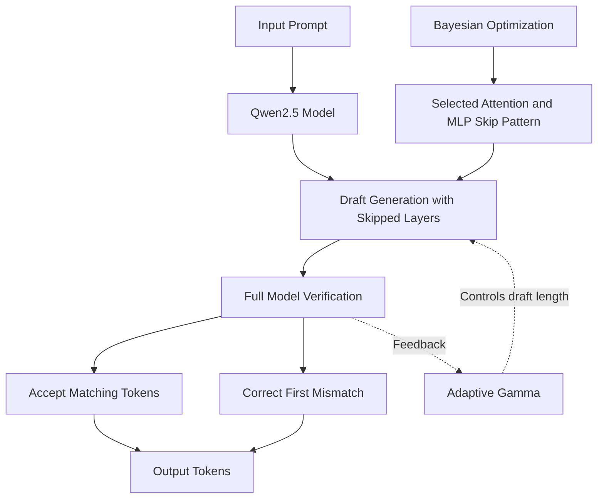

# Qwen2.5 Self-Speculative Decoding

An implementation of **self-speculative decoding for Qwen2.5**, combining layer skipping, adaptive gamma, and Bayesian optimization to explore efficient inference configurations.

The project investigates how skip-layer selection and task-specific optimization prompts affect speculative decoding performance.

## Architecture



## Models and Optimization

| Model | Search prompts | Purpose |
|---|---|---|
| Qwen2.5-7B-Instruct | 5 GSM8K reasoning prompts per candidate | Task-oriented skip-layer optimization and GSM8K evaluation |
| Qwen2.5-1.5B | 8 general prompts during search | Separate skip-layer configuration and implementation |

Bayesian optimization searches for attention and MLP layer-skipping patterns. The selected configuration is stored in a model-specific JSON file.

**Hardware note:** The Qwen2.5-1.5B experiments were run locally in VS Code using CPU-only inference. The Qwen2.5-7B benchmark was run separately on an Intel 96-core CPU machine.

### Task-Specific Optimization

The prompts used during search can influence which skip-layer configuration is selected. In these experiments, configurations searched using general prompts, including ARC-style questions, showed weaker performance on some complex reasoning tasks.

This observation motivates using prompts representative of the intended workload and evaluating optimized configurations on separate tasks. It is an experimental observation, not a universal guarantee that one prompt category will always perform better.

## Reported Result

The Qwen2.5-7B-Instruct experiment achieved approximately **1.22× end-to-end speedup** under the reported evaluation setup.

- **Model:** Qwen2.5-7B-Instruct
- **Evaluation:** GSM8K
- **Precision:** BF16
- **Hardware:** Intel 96-core CPU

Results depend on the hardware, model configuration, prompt distribution, and evaluation methodology. The reported speedup applies to the 7B experiment; it should not be interpreted as a measured result for the 1.5B configuration.

## Repository Structure

```text
├── README.md
├── requirements.txt
├── decoding.py
├── searching_qwen_reasoning.py
├── skip_layers_qwen7b_reasoning_1000.json
├── skip_layers_qwen1.5B.json
├── gsm8k_ssd_new_eval.py
└── gsm8k_autoregressiverepo_eval.py
```

| File | Description |
|---|---|
| `decoding.py` | Self-speculative decoding implementation |
| `searching_qwen_reasoning.py` | Bayesian optimization for skip-layer selection |
| `skip_layers_qwen7b_reasoning_1000.json` | Selected 7B skip-layer configuration |
| `skip_layers_qwen1.5B.json` | 1.5B skip-layer configuration |
| `gsm8k_ssd_new_eval.py` | GSM8K evaluation using self-speculative decoding |
| `gsm8k_autoregressiverepo_eval.py` | Autoregressive baseline evaluation |
| `requirements.txt` | Python dependencies |

**Note:** The included GSM8K evaluation scripts target Qwen2.5-7B-Instruct. The 1.5B configuration is separate; equivalent full-dataset benchmark results should be reported only after running that evaluation.

## Setup

Clone the repository and install the dependencies in a Python virtual environment.

```bash
git clone https://github.com/RituAddepalli/qwen2.5-self-speculative-decoding.git
cd qwen2.5-self-speculative-decoding

python -m venv .venv
```

Activate the environment:

**Windows**
```powershell
.venv\Scripts\Activate.ps1
```

**Linux**
```bash
source .venv/bin/activate
```

Install dependencies:

```bash
pip install -r requirements.txt
```

Use the model paths, configuration files, and runtime settings required by the scripts. Check each script's arguments and configuration before running it.

## Limitations

- Skip-layer configurations may not transfer equally well across tasks.
- Token-level outputs may diverge under BF16 inference; matching final answers alone does not establish token-level losslessness.
- Performance depends on the model, hardware, and evaluation setup.
- This project is an adaptation and is not claimed to be a byte-for-byte reproduction of the official SWIFT implementation.

## Acknowledgements

Inspired by *Draft & Verify: Lossless Large Language Model Acceleration via Self-Speculative Decoding* and related work on self-speculative decoding.

## License

Add an appropriate license before distributing the repository for reuse.